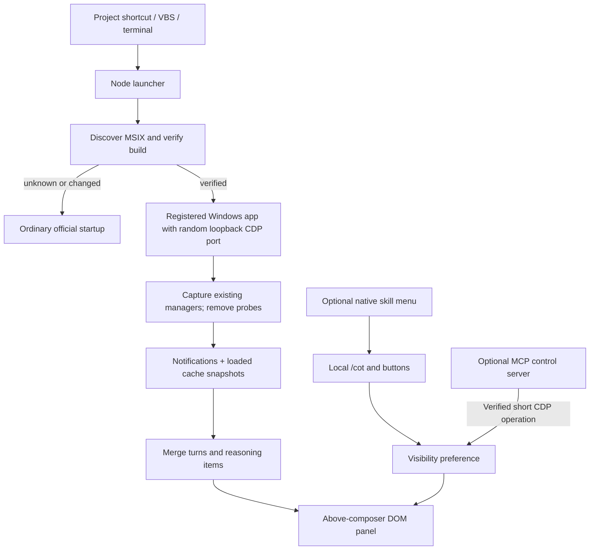

# Architecture

The companion consists of a Node.js launcher and plain JavaScript running
temporarily in the official desktop renderer. The native path has no npm dependency.
An optional, separate control process uses the MCP SDK.

## Launch and ownership

`Launch Codex.vbs` starts Node with a hidden console. Its path and the Node path
are quoted separately. The terminal launcher uses the same module.

The helper claims a named pipe derived from the current user's home and project
path. A second launcher can request only a fixed `activate` command. The protocol
does not evaluate supplied code or return reasoning/debug endpoints.

The launcher discovers the registered MSIX location and application identity from
its manifest each time. It verifies the internal application version plus
renderer asset SHA-256 values before enabling capture. Unknown or changed builds
start normally.

On a cold, verified launch, Windows activates the registered application through
`IApplicationActivationManager`, with only temporary loopback debug flags.
The short-lived PowerShell host uses `CLSCTX_LOCAL_SERVER` so activation argument
lifetime is independent of the host.
Activation preserves the package identity used by the updater and restart
lifecycle; launching the package's executable directly does not.
The helper verifies that the resulting process belongs to the expected package.

The helper briefly binds a loopback socket to select an available port, closes
that socket, and passes its explicit nonzero number to Chromium. Passing a
literal `--remote-debugging-port=0` would instead enable Chromium's automation
state in an otherwise ordinary desktop window. The helper waits for the activated
PID to own that loopback listener before making a CDP request, and accepts only
eligible `app://-/index.html` composer pages. Overlay pages are excluded.
Process existence checks use signal zero, without sending a real signal or
terminating the app. The helper stays alive until the desktop exits.

An already running ordinary desktop cannot acquire the needed startup flag
through second-instance activation. The helper activates it and requests one
normal exit/reopen through the new entry. An already attached desktop is simply
activated. The launcher never terminates the desktop.

## Manager capture and observation

The supported build does not expose its manager class as a public extension API.
`capture.mjs` uses three bounded, fingerprint-bound method locations. Conditional
CDP probes return false, capture the existing `this` manager, and do not pause.
After manager capture, the helper removes the probes and disables its Debugger
session.

`adapter.js` observes the manager's local notification callback and wraps selected
state updates. It saves descriptors and restores only wrappers it still owns.
It does not create another app-server, resume a thread, or send a model request.

The active conversation is resolved from the visible composer's portal marker.
An empty portal may be hidden by native CSS, so portal visibility alone is not
sufficient to select the correct conversation.

## History and rendering

The adapter merges native cached turns, loaded history islands, and live deltas
into an in-memory turn/item store. Partial snapshots do not delete previously
observed reasoning. Ordering follows known neighboring native records.

For each reasoning item, Auto chooses a nonempty summary, otherwise readable
content. The panel joins items in turn order. Summary/Raw modes do not silently
substitute the other channel.

Selecting an older turn holds that selection while new turns arrive. Scrolling
up pauses following. A frame scheduler with a timer fallback supports hidden
windows with suspended animation frames.

`resize.js` owns its handle, cursor cleanup, and height preference.
The handle overlays the top edge without a visible grip or a separate layout row.
The reasoning body can shrink to 28 pixels beneath its header. Smaller requested
heights snap to an 18-pixel single-line body, with the indicator beside it and the
title and navigation hidden through CSS. The same text node and history selection
remain in place, so streaming and scrolling continue. Expanding, resetting, or
canceling a drag restores the appropriate layout. The existing saved height key
and body-height semantics are preserved.
`controls.js` consumes exact single-line local commands at window capture phase,
before the native editor's submission path. It verifies the editor contains a
single text block and the caret is at the end, then clears it using a bounded
editor selection and browser editing command. It does not mutate ProseMirror's
internal document directly. Unrelated drafts and the Stop button retain native
handling.

An optional plugin registers three skills, rather than attempting to register
MCP prompts as native slash actions. The local handler accepts only exact paths
registered by the installer. It can identify a selected native option from its
read-only React key, using `aria-current` or `aria-selected` to respect the
highlighted native suggestion row. Tab, Enter, and clicking apply the control
immediately. If an earlier native keyboard listener inserts a `skillMention`
chip first, that same exact-path check executes it during the same key press.
Other paths, attachments, and mixed text remain native drafts.

The separate MCP server provides four fixed visibility tools and two settings
tools. A strict settings schema permits only display mode, scrolling preference,
collapsed state, height, and indicator color. Settings are written atomically
under ignored project state, and explicit MCP environment values are read at
startup. A short connection to the verified desktop endpoint applies them through
the fixed panel configuration API. Reasoning deltas never flow through MCP.
See [control plugin details](CONTROL-PLUGIN.md) for lifecycle and installation.

The English header contains only a theme-accent indicator, `Thinking` / `Done`,
and `‹ n/m turns ›` navigation. The label, indicator, and status API's `isRunning`
follow the current session's latest turn, independently of the selected history
turn. The automatic indicator uses a CSS variable reference so changing the Codex
accent updates it without polling.

Hot updates retain the adapter's full session cache inside the renderer before
replacing its listener wrappers. Importing that cache preserves live-only items
and turns that are no longer present in native snapshots. The handoff never
returns reasoning bodies over CDP or writes them to disk.

## Visibility and data

Hiding the panel detaches its DOM and removes the command hint. No reopen button
or placeholder remains. The adapter, helper, and in-memory history keep running;
the local `/cot on` command remounts the panel. Height and enabled state use
namespaced localStorage keys; reasoning text is not written there.

Launch records, shortcut manifests, copied icons, and synthetic reports live in
ignored `.local/`. Status records can contain local paths and thread IDs. The
project does not change provider settings, session databases, project lists,
installed application files, filesystem permissions, or directory links.

## Cleanup and compatibility

Normal disposal removes owned DOM/listeners, restores owned wrappers, removes
capture probes, and closes connections. The CDP endpoint belongs to the official
desktop and closes with that process. Force-killing the helper can leave the
in-memory component until desktop exit.

Avoiding installed file changes does not guarantee future internal compatibility.
An update can disable the companion without requiring an application repair.
Every new supported build requires interface and runtime validation.
